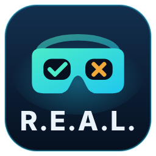

# R.E.A.L. Mod Manager

**English** · [Deutsch](#deutsch)

A Windows GUI to install, update and **cleanly uninstall** Luke Ross' **R.E.A.L. VR** mod.
Every installation is recorded before and after (game folder, settings folders, registry, folder permissions, NVIDIA profile), so uninstalling restores the original state – and a final check reports any leftovers.

> R.E.A.L. VR is made by Luke Ross and is **not** included. Get it from his Patreon: **[patreon.com/c/realvr](https://www.patreon.com/c/realvr)** – then import the downloaded ZIP into the manager.

## Features

* Import mod ZIPs (current and older versions such as v19), switch between versions
* Finds installed games by reading the store lists (Steam, Epic, GOG, Ubisoft, EA, Rockstar, Amazon, Heroic, Xbox) – no full disk scan; cached for instant start
* Shows **all** games supported by the loaded mod version – games not on your PC are dimmed, with store info and a link to the Steam store
* Compatibility assessment per game (VR runtime, dedicated GPU, VRAM, Game Pass folders, first-run requirements …)
* Install / update / uninstall with full journal; legacy removal for installs made without the manager
* Registry snapshots (mod-relevant keys only), compare and restore; optional Windows restore point
* NVIDIA driver profile (V-Sync fix) is reset **only for that game**
* Covers from Steam's local cache or (with your consent) from the Steam/Epic store; own pictures possible
* Dark / light / system theme · German, English, French – more languages can be downloaded in the app
* Automatic update check via GitHub releases (asks before installing, can be turned off in *Info > Build info*)
* "Clean up data" to free space (archived journals, old registry exports, logs, image cache)

## Download & start

From [Releases](https://github.com/urscaviezel/R.E.A.L.-Mod-Manager/releases):

* **`…-Setup.exe`** – installer (Program Files, start menu entry; data in `%ProgramData%\R.E.A.L. Mod Manager`)
* **`…-portable.zip`** – unzip anywhere and run `R.E.A.L. Mod Manager.exe`; data is kept in the `Data` folder next to it

Requirements: Windows 10/11 (Windows PowerShell 5.1 is built in), administrator rights (the mod's own installer needs them), a VR runtime such as SteamVR or Virtual Desktop.
Start with `--debug` to see the PowerShell console.

## Build from source

`build\Build-Release.cmd` creates the portable ZIP and – if [Inno Setup 6](https://jrsoftware.org/isdl.php) is installed – the installer in `dist\`.
`tests\Run-Selftest.cmd` runs the logic tests against simulated games (needs an extracted mod folder next to the project).
Translations: copy `lang\en.json`, translate, save as `lang\<code>.json` – pull requests welcome.

## License & credits

GPL-3.0-or-later. R.E.A.L. VR: Luke Ross, [Patreon](https://www.patreon.com/c/realvr). Ideas: [LukeRossCleaner](https://github.com/Yelodress/LukeRossCleaner) (Yelodress, MIT), DLSS 5 Autopilot (MIT). Not affiliated with Luke Ross.

---

# Deutsch

Installer/Uninstaller mit GUI für Luke Ross' **R.E.A.L. VR** Mod.
Jede Installation wird vollständig protokolliert (vorher/nachher), damit die Deinstallation den Ausgangszustand exakt wiederherstellt.

> R.E.A.L. VR stammt von Luke Ross und ist **nicht** enthalten. Den Mod gibt es auf seinem Patreon: **[patreon.com/c/realvr](https://www.patreon.com/c/realvr)** – die heruntergeladene ZIP dann im Manager importieren.

### Starten

Download unter [Releases](https://github.com/urscaviezel/R.E.A.L.-Mod-Manager/releases):

* **`…-Setup.exe`** – Installer (Programme, Startmenü). Daten unter `%ProgramData%\R.E.A.L. Mod Manager`.
* **`…-portable.zip`** – irgendwo entpacken, `R.E.A.L. Mod Manager.exe` starten. Daten im Ordner `Data` daneben.

Windows fragt beim Start nach Administratorrechten. Bei Problemen mit `--debug` starten (zeigt das PowerShell-Fenster). Aus dem Quellcode: `Start-RealVRManager.cmd` bzw. `Start-RealVRManager-Debug.cmd`.
Voraussetzung: Windows 10/11 mit Windows PowerShell 5.1 (vorinstalliert), eine VR-Runtime wie SteamVR oder Virtual Desktop.

Daten = Mod-Bibliothek, Protokolle, Sicherungen, Cover, Logs, Spiele-Cache.

### Oberfläche

* **Menü oben:** R.E.A.L. Mod · Spiele · Sicherung · Ansicht · Einstellungen · Info
* **Bibliothek:** alle modbaren Spiele der Mod-Liste. Spiele, die nicht auf diesem PC sind, erscheinen abgedunkelt (Bilder nur mit Online-Erlaubnis). Kopfzeile: Mod-Version · modbar · auf diesem PC · mit Mod · Updates. Filter: Alle | R.E.A.L. Mod: Installiert / Update / Nicht installiert. Klick auf ein Spiel öffnet die Detailseite (Installieren, Aktualisieren, Deinstallieren, Ordner, Protokoll, eigenes Bild setzen/entfernen; bei fehlenden Spielen Hersteller, Release, Beschreibung und Link zum Steam-Shop).
* **Footer:** dedizierte Grafikkarte und gefundene VR-Runtimes. Gelb = Voraussetzung fehlt (Tooltip zeigt Details).
* **Einstellungen:** Sprache (Dateien in `lang\`), Design Dunkel / Hell / Wie Windows, Cover und Infos aus dem Internet laden (ja/nein).
* **Info:** Anleitung, Build-Info.

### Spielesuche

Wie bei DLSS 5 Autopilot werden keine Festplatten durchsucht, sondern die Listen der Stores gelesen: Steam (appmanifest), Epic (Manifeste), GOG, Ubisoft, EA, Rockstar, Amazon, Heroic, Xbox/Game Pass sowie Ordner wie `D:\Games`, `D:\Spiele`. Das Ergebnis wird in `Data\library.json` gespeichert – beim nächsten Start ist die Bibliothek sofort da, durchsucht wird nur Neues. *Spiele > Vollständig neu suchen* ignoriert den Cache.

### Cover

1. eigenes Bild (Detailseite > Bild ändern)
2. Steams lokaler Bildercache
3. online (nur mit Zustimmung): Epic-Katalog bzw. Steam-Store-Suche nach Spielname → Bild vom CDN, lokal gespeichert

### Sicherungen

| Bereich | Inhalt |
|---|---|
| Spielordner | Dateiliste; Inhalte der Dateien direkt im EXE-Ordner + `RealRepo`, `doomSandBox` |
| Einstellungsordner | aus der `RealConfig.bat` ermittelt (Documents, AppData, Saved Games …) |
| Ordner ausserhalb | z.B. `..\..\user.cfg` (KCD2), `openxr_loader.dll` (High on Life) |
| `C:\ProgramData\RealVR` | Vulkan-Layer-Dateien (DOOM, Indiana Jones) |
| Registry | intern `HKCU\Software` + Khronos; zurückgesetzt werden nur Mod-relevante Schlüssel |
| Ordnerrechte | ICACLS-Änderung der `RealConfig.bat` |
| NVIDIA | Treiberprofil-Eintrag des Spiels (V-Sync von Vdesync) – wird **nur für dieses Spiel** zurückgesetzt |

**Registry-Sicherung (Menü Sicherung):** Snapshots enthalten nur die Mod-relevanten Schlüssel (Vulkan/OpenXR und Grafik-Einstellungen der unterstützten Spiele) – kein Rauschen mehr von tausenden fremden Einträgen.

**Windows-Wiederherstellungspunkt:** frei benennbar. Nur als Notfall-Rettung direkt nach einer Installation gedacht – später zurückgespielt macht er alle seitherigen Änderungen am PC rückgängig.

### Updates

*Info > Nach Updates suchen* (oder in der Build-Info) fragt GitHub-Releases von `urscaviezel/R.E.A.L.-Mod-Manager` ab. In der Build-Info lässt sich die automatische Prüfung beim Start abschalten und auf Wunsch auch Vorabversionen anbieten. Vor jeder Installation wird nachgefragt (mit Änderungsnotizen, „Später“, „Version überspringen“).
Portable Version: Release-ZIP wird geladen, ein kleiner Hilfsprozess ersetzt nach dem Beenden die Programmdateien (`Data` bleibt unangetastet) und startet neu. Installer-Version (`InstallType: installer` in version.json): die Setup-EXE des Releases wird gestartet.

### Speicherplatz

Nach einer sauberen Deinstallation (keine Rückstände) bleiben im Archiv (`Data\Journals\_Archiv`) nur Protokoll und Bericht (wenige KB); die Sicherungen werden gelöscht. Bei Rückständen bleibt die volle Sicherung erhalten. *R.E.A.L. Mod > Daten aufräumen…* zeigt, was Platz belegt (Archiv, eigene Registry-Exporte, alte Logs, Bildercache) und löscht die ausgewählten Einträge.

### Sprachen

`lang\de.json`, `lang\en.json`, `lang\fr.json`. *Einstellungen > Sprache > Sprachen verwalten…* zeigt die lokalen und die im GitHub-Repository verfügbaren Sprachen: Haken = installieren/aktualisieren, kein Haken = löschen. Die Online-Quelle wird in `version.json` eingetragen (`Repository` = GitHub-Adresse, Sprachdateien im Ordner `lang`, oder direkt `LanguageSource`). Eigene Sprachen: Datei kopieren, übersetzen, als `lang\<code>.json` speichern.

### Release bauen (lokal)

`build\Build-Release.cmd` doppelklicken. Ergebnis in `dist\`:

* `R.E.A.L.-Mod-Manager-<Version>-portable.zip` – Ordner mit `R.E.A.L. Mod Manager.exe` (Starter, C#, kompiliert mit dem csc.exe des .NET Framework), Daten in `Data` daneben.
* `R.E.A.L.-Mod-Manager-<Version>-Setup.exe` – nur wenn [Inno Setup 6](https://jrsoftware.org/isdl.php) installiert ist. Installiert nach *Programme*, Daten unter `%ProgramData%\R.E.A.L. Mod Manager`, Startmenü-/Desktop-Verknüpfung, Deinstallation warnt bei noch installierten Mods und fragt, ob die Daten gelöscht werden sollen.

Für GitHub-Releases: Tag `v<Version>`, beide Dateien als Assets anhängen – der Update-Mechanismus nimmt automatisch die passende.

### Test

`tests\Run-Selftest.cmd` testet die Logik mit simulierten Spielen in `tests\_work` (fasst keine echten Spiele an).

### Lizenz / Credits

GPL-3.0-or-later. R.E.A.L. VR (Luke Ross, [Patreon](https://www.patreon.com/c/realvr)) ist nicht enthalten – du importierst deine eigene ZIP. Kein offizielles Projekt von Luke Ross. Ideen: LukeRossCleaner (Yelodress, MIT), DLSS 5 Autopilot (MIT).
